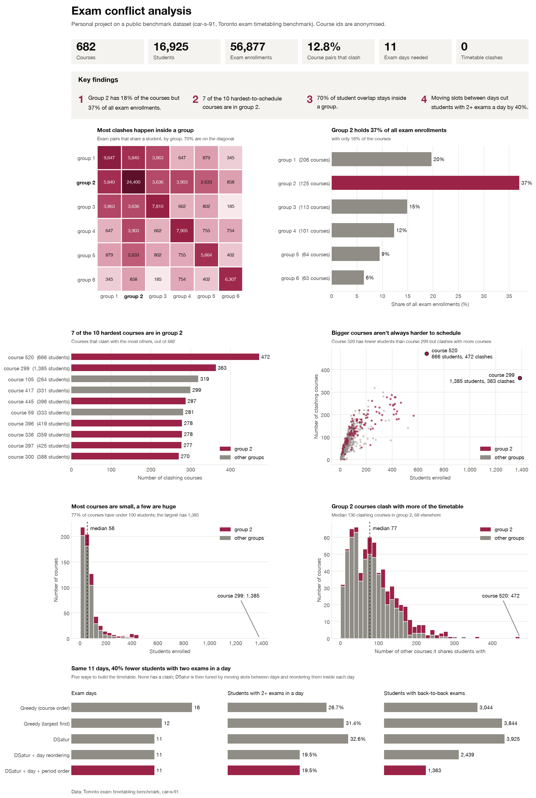
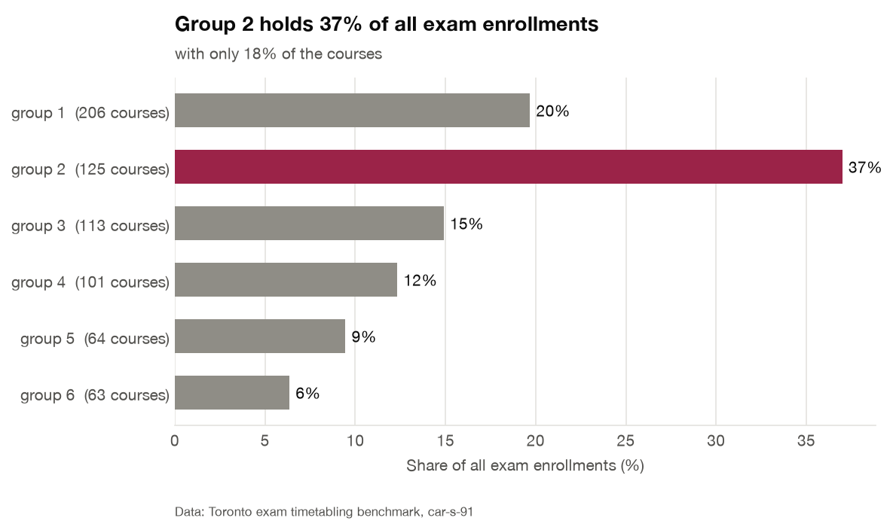
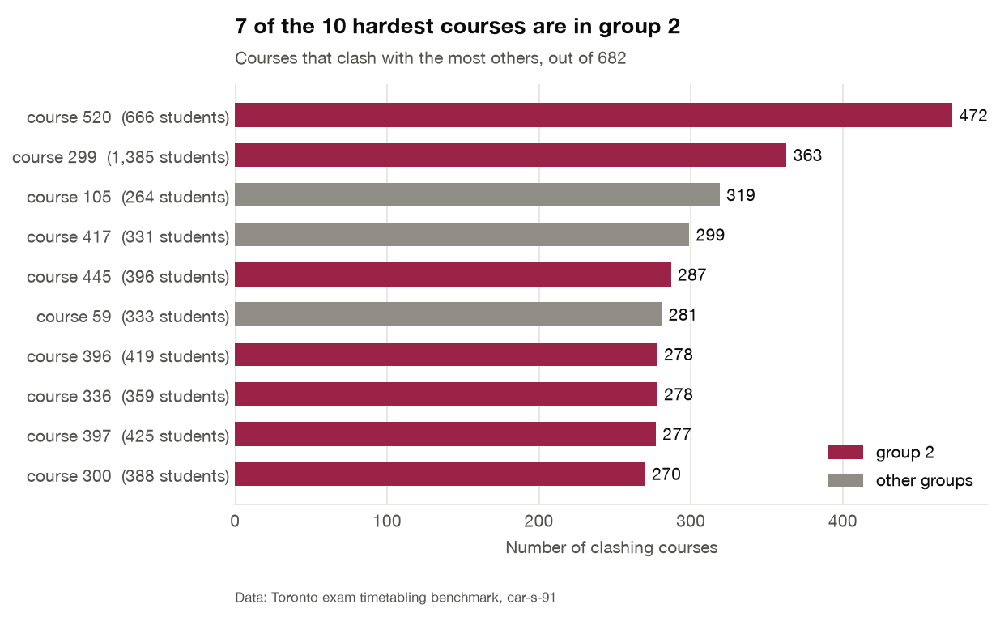
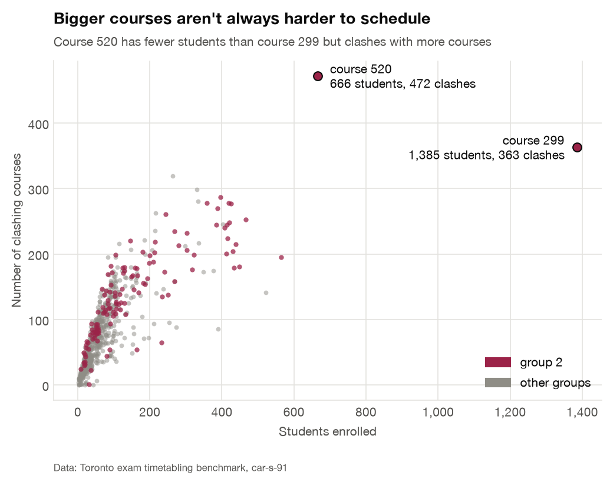
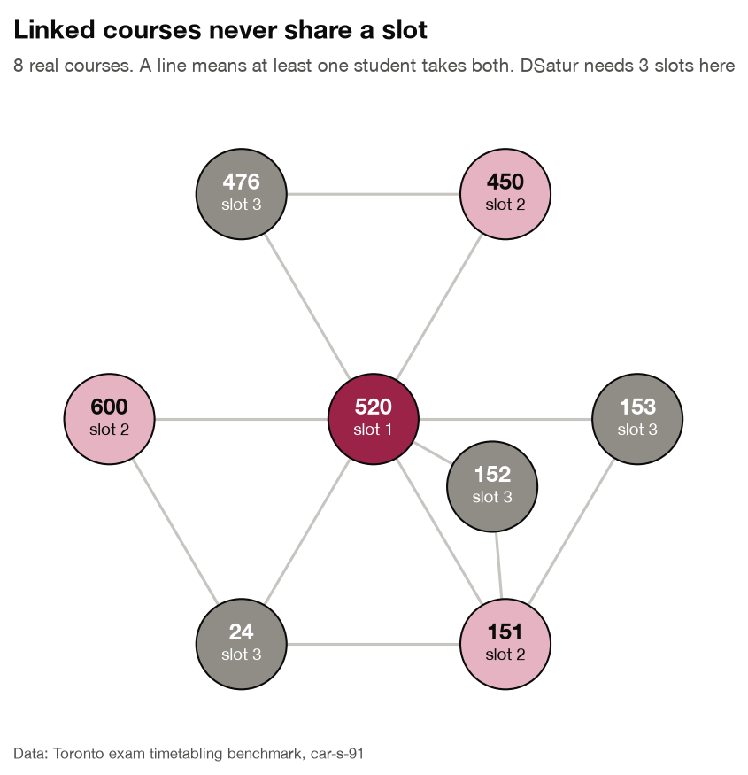
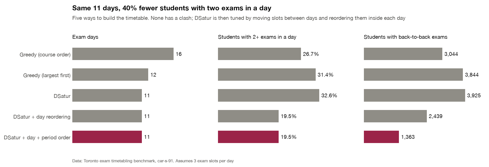
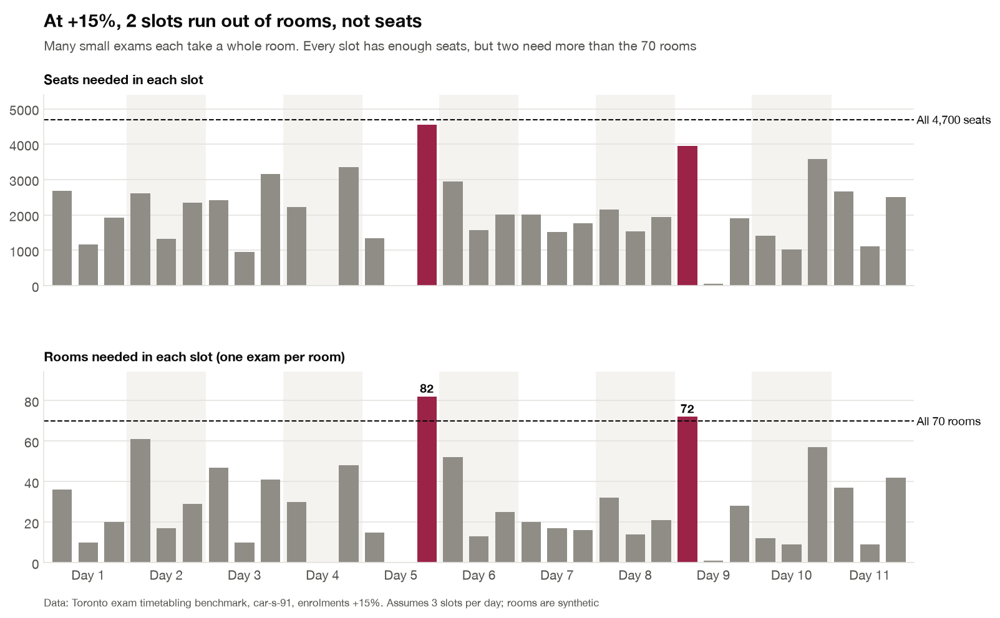

# Exam Timetabling & Analytics

A personal project that builds a clash-free university exam timetable and reports on it, using a public benchmark dataset.

> **Data note.** This project uses `car-s-91` from the Toronto exam timetabling benchmark: real but anonymised student enrolments from Carleton University. It was not built for, or with data from, any current institution. Room data is synthetic (see [Assumptions](#assumptions-and-limitations)).

## In short

A university has to fit every student's exams into as few days as possible, with no student in two exams at once, and preferably not two in one day. This project builds that timetable for 682 courses and 16,925 students, seats it in rooms, and reports on it.

- **No clashes in 11 exam days** (31 slots), using DSatur graph colouring.
- **40% fewer students with two exams in a day** and **65% fewer with back-to-back exams**, by reordering the same slots.
- **Every student seated** in 70 rooms; the busiest slot uses 84% of all seats.
- **At 15% more students, rooms run out before seats do**: 237 students are left without a room. Two fixes are costed: 12 extra classrooms, or moving 12 small exams.
- **Excel report** with a dashboard, pivot table and per-student sheet: [download `exam_report.xlsx`](outputs/exam_report.xlsx) (GitHub can't preview it; it opens in Excel or Excel for the web).



## Results at a glance

| | |
|---|---|
| Courses / students / exam enrolments | 682 / 16,925 / 56,877 |
| Course pairs that share at least one student | 12.8% |
| Exam slots needed (DSatur) | 31 slots, 11 days (lower bound: 23; benchmark standard: 35) |
| Clashes (a student with two exams at the same time) | 0 |
| Students with 2+ exams in one day | 5,519 → **3,302 (−40%)** after moving slots between days |
| Students with back-to-back exams | 3,925 → **1,363 (−65%)** after reordering slots inside each day |
| Rooms | 70 rooms, 4,700 seats; every student seated; busiest slot uses 84% of all seats |
| Enrolments +15% | 237 students without a room; fixed by 12 extra classrooms or by moving 12 small exams |

## What was done

Click a step to open it.

<details>
<summary><b>1. Data</b>: the loader reproduces the published dataset statistics exactly</summary>

Loaded the `.crs` (course, enrolment) and `.stu` (one line per student, listing their courses) files. As a check, the loader reproduces the statistics published with the dataset exactly: 682 exams, 16,925 students, 56,877 enrolments, density 0.13. Enrolment counted from the student file matches the course file for all 682 courses.

</details>

<details>
<summary><b>2. Conflict analysis</b>: one group of courses holds 37% of enrolments and most of the hard-to-schedule courses</summary>

Two courses *clash* if at least one student takes both, so their exams can't be at the same time.

- **Conflict matrix:** for every pair of courses, the number of shared students. 29,814 of 232,221 course pairs (12.8%) clash.
- **Bottleneck courses:** courses that clash with the most others. Course 520 (666 students) clashes with 472 of the 682 courses, more than course 299, the largest course (1,385 students, 363 clashes). Size alone doesn't predict how hard a course is to schedule.
- **Course groups:** Louvain community detection on the conflict graph finds 6 main groups. 70% of all student overlap stays inside a group.
- **Group 2** has 18% of the courses but 37% of all exam enrolments, and 7 of the 10 hardest-to-schedule courses. Its courses clash with a median of 136 other courses, against 68 elsewhere.

| | |
|---|---|
|  |  |
|  |  |

</details>

<details>
<summary><b>3. Scheduling</b>: DSatur needs 31 slots (11 days); no timetable can use fewer than 23</summary>

Each course is a node; two courses are joined if they share a student. Giving every node a colour so that no two joined nodes share one is the same as giving every exam a time slot so that no student has two exams at once. Fewer colours means a shorter exam period.



Finding the minimum is NP-hard, so three greedy orderings were compared:

| Method | How it picks the next course | Slots | Days |
|---|---|---|---|
| Greedy, course order | by course id | 48 | 16 |
| Greedy, largest first (Welsh–Powell) | most clashes first | 34 | 12 |
| **DSatur** | the course whose neighbours already use the most different slots | **31** | **11** |

DSatur gave the shortest timetable, below the 35 slots commonly used for this instance. It is not proven optimal: the conflict graph contains 23 courses that all clash with each other (a maximum clique), so no timetable can use fewer than 23 slots. The best answer lies somewhere between 23 and 31. But shorter timetables pack exams into fewer days: students with 2+ exams in a day went *up* from 26.7% to 32.6%.

</details>

<details>
<summary><b>4. Making the timetable kinder to students</b>: same slots, 40% fewer students with two exams a day</summary>

The slot a course gets only fixes which exams run together. Which day each slot lands on is free, and moving a whole slot never creates a clash.

- **Between days (hill climbing):** swap two slots on different days, keep the swap if fewer students end up with 2+ exams in a day, repeat until no swap helps. 5,519 → 3,302 students (−40.2%), with the same 31 slots and 11 days.
- **Inside a day (exhaustive):** with 3 slots a day there are only 6 possible orders, so all are tried and the one with the fewest back-to-back exams kept. 2,439 → 1,363 students.



Every timetable is checked against the raw student lists (not the graph) for clashes, and the run stops if any are found.

</details>

<details>
<summary><b>5. Rooms</b>: everyone seated in 70 rooms; the busiest slot uses 84% of seats</summary>

Each slot's courses are seated largest first, each in the smallest free room that holds it. A course too big for any free room takes the biggest one and the rest of its students go to the next room. One course per room per slot.

With 70 rooms and 4,700 seats, all 56,877 exam seats are placed. Booked rooms are 70.2% full on average; the busiest slot uses 62 of the 70 rooms and 84% of all seats; 111 courses are split over two or more rooms (course 299 uses six). The full plan is in `outputs/timetable.csv`.

</details>

<details>
<summary><b>6. Excel report</b>: dashboard, pivot table and per-student sheets, built from Python</summary>

`outputs/exam_report.xlsx` is built by `src/excel_report.py` and opens without Python:

| Sheet | What it holds |
|---|---|
| Dashboard | KPI tiles, before/after chart, method comparison, seat-use heatmap (day × period), room use by type |
| KPI | every headline number in one table |
| Pivot | exam seats by day and period (a real Excel pivot table) |
| Timetable | one row per course and room, with a fill bar per room |
| Courses | one row per course: day, period, rooms |
| Students | per student: exams, exam days, most exams in a day, back-to-back (2+ and "Yes" highlighted) |
| Enrolments | student–course pairs, for lookups |

Charts are native Excel charts, so they stay editable. The script checks itself before saving: the per-student sheet must give the same 3,302 and 1,363 as the timetable metrics, and the seats must add up to the 56,877 enrolments.

The pivot shows something the summary numbers hide: midday holds only 8,887 of 56,877 exam seats, and two middays are empty. Reordering inside each day puts the lightest slot in the middle, because midday touches both other periods, and the two spare slots of the 11-day calendar end up there too.

</details>

<details>
<summary><b>7. Growth scenario</b>: at +15%, rooms run out before seats do</summary>

Every course grows by 15% (rounded up), from 56,877 to 65,732 exam seats. Which courses students take together stays the same, so the timetable stays clash-free (`src/projection.py`).



| Scenario | Rooms | Days | Unseated | Busiest slot | 2+ exams/day | Back-to-back |
|---|---|---|---|---|---|---|
| Today | 70 | 11 | 0 | 84.0% | 19.5% | 1,363 |
| +15%, no change | 70 | 11 | **237** | 92.1% | 19.5% | 1,363 |
| +15%, 12 extra classrooms | 82 | 11 | 0 | 90.0% | 19.5% | 1,363 |
| +15%, move 12 small exams | 70 | 11 | 0 | 92.1% | 19.5% | 1,372 |

- **Rooms run out before seats do.** The worst slot (day 5, afternoon) needs 4,555 seats out of 4,700, but a room holds one exam at a time, so its many small exams fill all 70 rooms and 227 students are left without a seat. Day 9 morning is short by 10.
- **Option 1, more rooms:** 12 extra 30-seat classrooms seat everyone.
- **Option 2, move exams:** the 12 smallest exams in those two slots (5 to 35 students each) move to a slot on the same day where none of their students has another exam. Day 5 midday was empty, so 10 of them go there. No extra rooms or days; the cost is 9 more students with back-to-back exams, and nobody gets a new exam day.

Student shares assume the new students take courses like the current ones.

</details>

## Decisions and alternatives

<details>
<summary>Why this dataset, these methods and these charts</summary>

**Why `car-s-91`?** The Toronto benchmark has 13 instances. `yor-f-83` (941 students) and `ute-s-92` (2,750) are small; `car-s-91` (16,925 students, 682 courses) is closer to a mid-sized university.

**Why a library for colouring?** NetworkX's `greedy_color` implements all three orderings and is well tested. The project's focus is comparing them and measuring the result, not re-implementing them.

**Why compare same-day exams *within* DSatur, not DSatur against greedy?** The methods use different numbers of slots, and fewer slots alone push more exams onto the same day. Keeping the slots fixed and changing only their days isolates the effect of the reordering, so the 40% is a fair comparison.

**Why hill climbing?** It is simple, deterministic and easy to explain, and it runs in about two seconds. It stops at a local optimum; simulated annealing or a constraint solver (OR-Tools CP-SAT) could do better.

**Why groups instead of a course-by-course heatmap?** A 682 × 682 heatmap was tried first. At any readable size each course is less than a pixel, so it looked like noise even after aggregating into blocks. The 6 × 6 group matrix shows the same pattern with numbers a reader can quote. Group numbers are labels only: the data is anonymised, so groups are not claimed to be departments.

**Why one accent colour?** Group 2 is the story in most charts, so it alone gets a colour and everything else is grey. The colour scale in the group matrix uses the same accent, so colours mean the same thing everywhere.

**Why best-fit rooms?** Putting each course in the smallest room that fits keeps large rooms free for large courses. Filling the biggest rooms first would leave big courses without space.

</details>

## Assumptions and limitations

- **3 exam slots per day** (morning, midday, afternoon). The benchmark has no days; all same-day and back-to-back numbers depend on this. With the same 31 DSatur slots (`src/sensitivity.py`):

  | Slots per day | Days | 2+ exams/day, DSatur | 2+ exams/day, tuned | Back-to-back, tuned |
  |---|---|---|---|---|
  | 2 | 16 | 19.5% | 9.0% | 1,528 |
  | 3 | 11 | 32.6% | 19.5% | 1,363 |
  | 4 | 8 | 44.8% | 31.3% | 2,011 |

  Fewer slots a day means a longer exam period but fewer students with two exams in a day; this is a policy choice, not a technical one.
- **Rooms are synthetic:** 2 sports halls (400 seats), 8 lecture halls (150), 30 large classrooms (60), 30 classrooms (30). Capacities are exam seats, about half of normal lecture seats since every other seat is left empty. Large exams in sports halls are common practice at Canadian universities. The mix is a reasonable guess, not taken from a real campus.
- **Course ids are anonymised**, so findings are about structure, not named courses.
- Same-day and back-to-back counts are per student (a student counts once however many such days they have).
- Not modelled: invigilators, room distance for split courses, exams that must be on a given day.
- Results are deterministic for the pinned library versions in `requirements.txt`.

## Not done yet

- A constraint-programming model (OR-Tools CP-SAT) that handles slots, rooms and same-day exams together, to see how far below 31 slots it can get.
- A small web front end (Streamlit) to try scenarios without running scripts.

## Run it

```bash
python3 -m venv .venv
source .venv/bin/activate
pip install -r requirements.txt

python src/run_all.py      # everything below, in order

python src/load_data.py    # load and check the data
python src/analysis.py     # conflict analysis and charts
python src/scheduler.py    # build and compare timetables, lower bound
python src/rooms.py        # seat exams in rooms, write outputs/timetable.csv
python src/sensitivity.py  # 2, 3 or 4 slots per day
python src/projection.py   # 15% enrolment growth
python src/dashboard.py    # one-page dashboard
python src/excel_report.py # outputs/exam_report.xlsx

pytest                     # data, clash, lower bound and room checks
```

The data files (`car-s-91.crs`, `car-s-91.stu`) go in `data/raw/`. They come from the [benchmark page](https://www.cs.nott.ac.uk/~pszrq/data.htm) (`Toronto.zip`).

## Project structure

```
data/
  raw/            benchmark files
  rooms.csv       synthetic rooms
src/
  load_data.py    read .crs / .stu
  analysis.py     conflict matrix, bottlenecks, course groups, charts
  scheduler.py    greedy / DSatur, day and period reordering, metrics
  rooms.py        room assignment
  sensitivity.py  slots-per-day scenarios
  projection.py   15% growth: unseated students, extra rooms or moved exams
  dashboard.py    one-page summary image
  excel_report.py Excel report with dashboard, pivot and lookup sheets
  run_all.py      run every step
tests/            pytest checks
outputs/          charts, dashboard, timetable.csv, slots_per_day.csv, growth_scenarios.csv, growth_rooms.png, exam_report.xlsx
```

## References

- Carter, M. W., Laporte, G., Lee, S. Y. (1996). Examination timetabling: algorithmic strategies and applications. *Journal of the Operational Research Society*, 47, 373–383. (the Toronto dataset)
- Brélaz, D. (1979). New methods to color the vertices of a graph. *Communications of the ACM*, 22(4), 251–256. (DSatur)
- Blondel, V. D., Guillaume, J.-L., Lambiotte, R., Lefebvre, E. (2008). Fast unfolding of communities in large networks. *Journal of Statistical Mechanics*. (Louvain)
