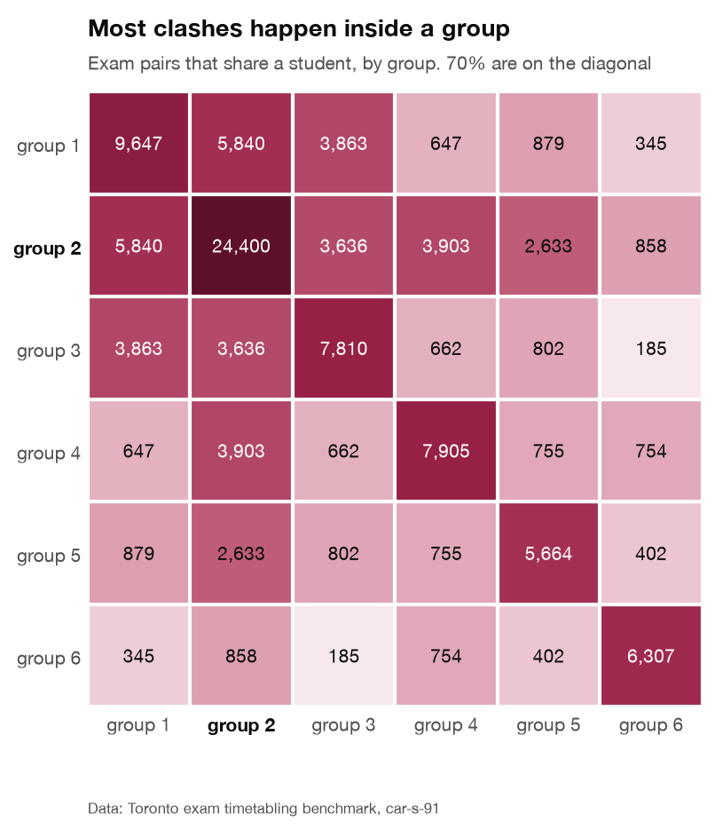

# Exam Timetabling & Analytics

A personal project that builds a clash-free university exam timetable and reports on it, using a public benchmark dataset.

> **Data note.** This project uses `car-s-91` from the Toronto exam timetabling benchmark: real but anonymised student enrolments from Carleton University. It was not built for, or with data from, any current institution. Room data is synthetic (see [Assumptions](#assumptions-and-limitations)).


## Results at a glance

| | |
|---|---|
| Courses / students / exam enrolments | 682 / 16,925 / 56,877 |
| Course pairs that share at least one student | 12.8% |
| Exam slots needed (DSatur) | 31 slots, 11 days (benchmark standard: 35 slots) |
| Clashes (a student with two exams at the same time) | 0 |
| Students with 2+ exams in one day | 5,519 → **3,302 (−40%)** after moving slots between days |
| Students with back-to-back exams | 3,925 → **1,363 (−65%)** after reordering slots inside each day |
| Rooms | 70 rooms, 4,700 seats; every student seated; busiest slot uses 84% of all seats |

## What was done

### 1. Data

Loaded the `.crs` (course, enrolment) and `.stu` (one line per student, listing their courses) files. As a check, the loader reproduces the statistics published with the dataset exactly: 682 exams, 16,925 students, 56,877 enrolments, density 0.13. Enrolment counted from the student file matches the course file for all 682 courses.

### 2. Conflict analysis

Two courses *clash* if at least one student takes both, so their exams can't be at the same time.

- **Conflict matrix:** for every pair of courses, the number of shared students. 29,814 of 232,221 course pairs (12.8%) clash.
- **Bottleneck courses:** courses that clash with the most others. Course 520 (666 students) clashes with 472 of the 682 courses, more than course 299, the largest course (1,385 students, 363 clashes). Size alone doesn't predict how hard a course is to schedule.
- **Course groups:** Louvain community detection on the conflict graph finds 6 main groups. 70% of all student overlap stays inside a group.
- **Group 2** has 18% of the courses but 37% of all exam enrolments, and 7 of the 10 hardest-to-schedule courses. Its courses clash with a median of 136 other courses, against 68 elsewhere.

| | |
|---|---|
|  |  |
|  |  |

### 3. Scheduling (graph colouring)

Each course is a node; two courses are joined if they share a student. Giving every node a colour so that no two joined nodes share one is the same as giving every exam a time slot so that no student has two exams at once. Fewer colours means a shorter exam period.

Finding the minimum is NP-hard, so three greedy orderings were compared:

| Method | How it picks the next course | Slots | Days |
|---|---|---|---|
| Greedy, course order | by course id | 48 | 16 |
| Greedy, largest first (Welsh–Powell) | most clashes first | 34 | 12 |
| **DSatur** | the course whose neighbours already use the most different slots | **31** | **11** |

DSatur gave the shortest timetable, below the 35 slots commonly used for this instance. But shorter timetables pack exams into fewer days: students with 2+ exams in a day went *up* from 26.7% to 32.6%.

### 4. Making the timetable kinder to students

The slot a course gets only fixes which exams run together. Which day each slot lands on is free, and moving a whole slot never creates a clash.

- **Between days (hill climbing):** swap two slots on different days, keep the swap if fewer students end up with 2+ exams in a day, repeat until no swap helps. 5,519 → 3,302 students (−40.2%), with the same 31 slots and 11 days.
- **Inside a day (exhaustive):** with 3 slots a day there are only 6 possible orders, so all are tried and the one with the fewest back-to-back exams kept. 2,439 → 1,363 students.


Every timetable is checked against the raw student lists (not the graph) for clashes, and the run stops if any are found.

### 5. Rooms

Each slot's courses are seated largest first, each in the smallest free room that holds it. A course too big for any free room takes the biggest one and the rest of its students go to the next room. One course per room per slot.

With 70 rooms and 4,700 seats, all 56,877 exam seats are placed. Booked rooms are 70.2% full on average; the busiest slot uses 62 of the 70 rooms and 84% of all seats; 111 courses are split over two or more rooms (course 299 uses six). The full plan is in `outputs/timetable.csv`.

## Decisions and alternatives

**Why `car-s-91`?** The Toronto benchmark has 13 instances. `yor-f-83` (941 students) and `ute-s-92` (2,750) are small; `car-s-91` (16,925 students, 682 courses) is closer to a mid-sized university.

**Why a library for colouring?** NetworkX's `greedy_color` implements all three orderings and is well tested. The project's focus is comparing them and measuring the result, not re-implementing them.

**Why compare same-day exams *within* DSatur, not DSatur against greedy?** The methods use different numbers of slots, and fewer slots alone push more exams onto the same day. Keeping the slots fixed and changing only their days isolates the effect of the reordering, so the 40% is a fair comparison.

**Why hill climbing?** It is simple, deterministic and easy to explain, and it runs in about two seconds. It stops at a local optimum; simulated annealing or a constraint solver (OR-Tools CP-SAT) could do better.

**Why groups instead of a course-by-course heatmap?** A 682 × 682 heatmap was tried first. At any readable size each course is less than a pixel, so it looked like noise even after aggregating into blocks. The 6 × 6 group matrix shows the same pattern with numbers a reader can quote. Group numbers are labels only: the data is anonymised, so groups are not claimed to be departments.

**Why one accent colour?** Group 2 is the story in most charts, so it alone gets a colour and everything else is grey. The colour scale in the group matrix uses the same accent, so colours mean the same thing everywhere.

**Why best-fit rooms?** Putting each course in the smallest room that fits keeps large rooms free for large courses. Filling the biggest rooms first would leave big courses without space.

## Assumptions and limitations

- **3 exam slots per day** (morning, midday, afternoon). The benchmark has no days; all same-day and back-to-back numbers depend on this.
- **Rooms are synthetic:** 2 auditoriums (400 seats), 8 lecture halls (150), 30 classrooms (60), 30 seminar rooms (30). Capacities are exam seats. They are a reasonable mix, not taken from a real campus.
- **Course ids are anonymised**, so findings are about structure, not named courses.
- Same-day and back-to-back counts are per student (a student counts once however many such days they have).
- Not modelled: invigilators, room distance for split courses, exams that must be on a given day.
- Results are deterministic for the pinned library versions in `requirements.txt`.

## Planned

- **Excel report:** timetable, per-student summary and KPI sheets with conditional formatting, plus a pivot table.
- **Growth scenario:** if enrolments grow 15%, do the current rooms still fit, and how many extra slots or days are needed?
- Optional: OR-Tools CP-SAT model with room capacity and same-day constraints; a small Streamlit front end.

## Run it

```bash
python3 -m venv .venv
source .venv/bin/activate
pip install -r requirements.txt

python src/load_data.py    # load and check the data
python src/analysis.py     # conflict analysis and charts
python src/scheduler.py    # build and compare timetables
python src/rooms.py        # seat exams in rooms, write outputs/timetable.csv
python src/dashboard.py    # one-page dashboard
```

The data files (`car-s-91.crs`, `car-s-91.stu`) go in `data/raw/`. They come from the [benchmark page](https://www.cs.nott.ac.uk/~pszrq/data.htm) (`Toronto.zip`).

## Project structure

```
data/
  raw/            benchmark files
  rooms.csv       synthetic rooms
src/
  load_data.py    read .crs / .stu
  analysis.py     conflict matrix, bottlenecks, course groups, charts
  scheduler.py    greedy / DSatur, day and period reordering, metrics
  rooms.py        room assignment
  dashboard.py    one-page summary image
outputs/          charts, dashboard, timetable.csv
```

## References

- Carter, M. W., Laporte, G., Lee, S. Y. (1996). Examination timetabling: algorithmic strategies and applications. *Journal of the Operational Research Society*, 47, 373–383. (the Toronto dataset)
- Brélaz, D. (1979). New methods to color the vertices of a graph. *Communications of the ACM*, 22(4), 251–256. (DSatur)
- Blondel, V. D., Guillaume, J.-L., Lambiotte, R., Lefebvre, E. (2008). Fast unfolding of communities in large networks. *Journal of Statistical Mechanics*. (Louvain)
